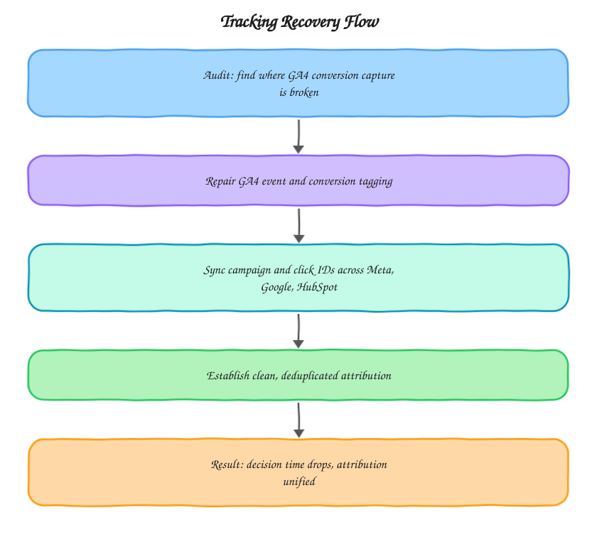

# Tracking Recovery Toolkit

A repair playbook for when GA4 conversion tracking is broken badly enough that a business genuinely can't tell where its leads are coming from. Built from the kind of tracking recovery work I do at [motabar.builds.stuff](https://motabarbuildstuff.com/), the sort of engagement that starts with someone saying their numbers just don't add up anymore.

## The problem this solves

Broken conversion tracking rarely fails all at once, it degrades. A GTM update here, a redirect change there, a new form embed that doesn't fire the right event, and six months later nobody can say with confidence which campaigns are actually generating leads. This toolkit is the audit-and-repair sequence for that situation: find exactly where capture is breaking, fix it at the source, then make sure IDs stay consistent across every platform touching the same lead.

## Architecture

The order matters. Diagnosis always comes before repair, and campaign ID syncing always comes after conversion capture is confirmed working, fixing ID sync on top of broken capture just produces consistently wrong data instead of inconsistently wrong data.

## What's in here

* `sql/conversion_capture_repair_check.sql` finds specific conversion events that should have fired but didn't, isolated by page and event type so the fix can be targeted
* `sql/cross_platform_id_sync.sql` checks whether the same lead has matching campaign and click IDs across GA4, the ad platform, and the CRM, flagging where they diverge

## How it's used in practice

The capture check runs first against a sample of known-converted sessions (a form submit confirmed in the CRM, a call confirmed in the call tracking tool) and checks whether GA4 shows a matching conversion event. Gaps here point directly at broken tag firing, missing trigger conditions, or a form embed that changed without updating the tracking. Once capture is confirmed reliable, the ID sync check catches a subtler problem: a lead that converted with a valid `gclid` in GA4 but shows up in the CRM with no source data at all, usually because the CRM integration wasn't capturing the parameter on lead creation.

## What good output looks like

`conversion_capture_repair_check.sql` should show conversion volume in GA4 that's within a few percent of the CRM's own record of leads and sales for the same period, small gaps are normal (a lead calling in without visiting the site first), large gaps point at a specific broken trigger. `cross_platform_id_sync.sql` should show the same campaign ID present in GA4, the ad platform, and the CRM for the large majority of converted leads.

## Setup

1. Get a sample of confirmed conversions directly from the CRM or call tracking tool for a known date range
2. Run `conversion_capture_repair_check.sql` against that sample to find where GA4 capture diverges
3. Fix the identified tagging gaps in GTM
4. Run `cross_platform_id_sync.sql` to confirm campaign IDs are consistent end to end

## Stack

BigQuery, Google Tag Manager, GA4, SQL

## Related

* Case study: [Fixing Broken Tracking & Unlocking Lead Growth](https://motabarbuildstuff.com/case-studies/fixing-broken-tracking-unlocking-lead-growth/)
* Guide: [Why is my GA4 direct traffic so high?](https://motabarbuildstuff.com/blog/why-is-ga4-direct-traffic-so-high/)
* Guide: [Why don't Meta, Google Ads and GA4 conversions match?](https://motabarbuildstuff.com/blog/why-meta-google-ads-ga4-conversions-dont-match/)
* Service: [GA4 audit and repair](https://motabarbuildstuff.com/ga4-setup-consultant/)

Built by [Motabar Javaid](https://motabarbuildstuff.com/about/), analytics engineer at [motabar.builds.stuff](https://motabarbuildstuff.com/).
